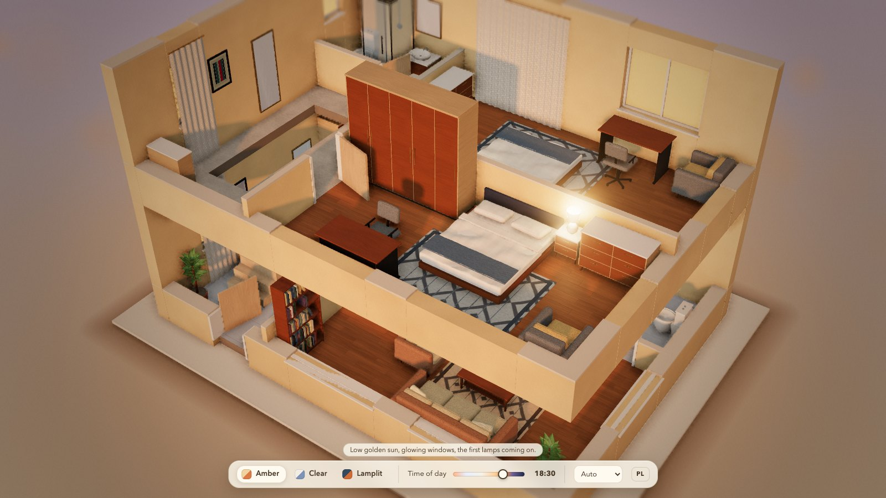

# plandoll

**[Open the demo](https://mrpawelcz.github.io/plandoll/)**

Turn a floor plan into a furnished, lit miniature of the flat, in your browser.



**Status: early work in progress.** The page furnishes every room by itself, lights the flat at a time of day you can move, and lets you turn the miniature around to see it from every side. It shows two built-in example plans (a flat and a duplex, picked with buttons), and one button lays the outer walls open like the sides of a dolls' house. A first version of the editor can be switched on with `edit=1` in the address (see below): it can move, turn, delete, add and duplicate pieces, change their size and colours, colour the walls and floor of a room, and save the layout to a file or load it back. A plan of your own can be pasted or loaded from a file (see Buttons and your own plan). It is not a CAD tool and not a phone app.

## Make a plan of your own

plandoll reads a small JSON file that describes the walls, doors, windows and rooms. You do not write it by hand: an AI chat assistant that can read pictures makes it from a picture of your floor plan.

1. Take a photo, a screenshot or a PDF page of your floor plan. Walls, doors and windows should be visible; sizes or room areas printed on it help to find the scale.
2. Open an AI chat assistant that can read pictures, attach the picture and paste the prompt: [`docs/PROMPT.md`](docs/PROMPT.md) in English, [`docs/PROMPT.pl.md`](docs/PROMPT.pl.md) in Polish. On the page, the Load plan box holds the same instruction and a Copy the prompt button.
3. Copy the whole answer of the assistant, press Load plan on the page, paste it and press Load. The page finds the plan in the answer. Compare the model with your drawing: a weaker assistant may leave out windows or move a wall. If the page names problems, they stay in the box, all of them in one list: copy the message, paste it back into the chat and ask for a corrected plan.

The picture goes to the assistant you choose and is covered by its rules; plandoll itself sends nothing anywhere. Take names and addresses off the picture first. How different kinds of plans are read is in [`docs/reading-plans.md`](docs/reading-plans.md), the format in [`docs/plan-format.md`](docs/plan-format.md).

## What works today

- **One HTML file.** `dist/plandoll.html` is a single file of about 1 MB and runs from a file or any static host: no server, no account, no tracking, no network requests, nothing stored in the browser. It needs a browser with WebGL 2; without it the page says so.
- **Automatic furnishing.** A layout engine reads the plan, recognises each room by its name (English or Polish) or by its shape, and places furniture and decor by simple rules: a sofa opposite a television, beds with night tables, kitchen units along a wall, bathroom fittings, lamps, curtains at windows, pictures, rugs and plants. The result is plain data (a list of pieces with position, rotation, size and colours) and it is deterministic: the same plan gives the same flat.
- **52 piece types built in code.** Sofas, armchairs, beds, wardrobes, tables and chairs, kitchen units and appliances, a sink, a toilet, a washbasin, a shower, a bath, bookcases, lamps, curtains, mirrors, pictures, rugs, plants and more. No model files are loaded. Every piece has named colour slots and most have a size range, so the editor can recolour and resize them.
- **A view from every side.** Drag with one finger or the left mouse button to turn the miniature around its centre. Two fingers zoom and move it at the same time: the point between your fingers stays under them, so pinching on a room zooms into that room. Three fingers move it with their middle. With the mouse, the right or the middle button (or Shift with the left button) moves it and the wheel zooms towards the pointer. Zoom runs from 0.2 to 1.8 times the starting distance, and the model can be moved as far as the edge of the card board it stands on (the board hugs the closed house and holds the walls as they fall) plus a hand's breadth, so it cannot be lost over the empty ground; without the shell the limit is the whole model plus 15 percent. A double tap, a double click, `0` or the Reset view button go back to the starting view: the turn, the zoom and the move. On a touch screen the first one-finger turn shows one line about this (1 finger: turn, 2 fingers: zoom and move, double tap: back) for about six seconds, once per page load. The walls that face you lower so the rooms stay in sight, on both levels of a duplex, while the other walls stay high. The arrow keys turn the view by 15 degrees (up and down tilt it by 10), `+` and `-` zoom, `1`, `2` and `3` pick a mood, and Shift with left or right moves the time of day. An idle page draws no frames. While the Open the shell button is on (the default), and on a phone (a window up to 760 px wide) in any case, the starting view keeps the whole model above the bars at the bottom, so the lower storey of a duplex is not hidden behind them, and the camera looks at the middle of the model with the centre of the picture moved up over the part above the bars: turning and zooming with the buttons or keys happen about what you see, not about a point behind the controls. The finger that is left after two fingers lift does nothing until it lifts too, so the model does not turn by itself at the end of a pinch.
- **A first editor (experimental, off by default).** Open the page with `edit=1` in the address, for example `dist/plandoll.html#edit=1`. Tap a piece to select it (a copper outline shows it) and drag it over the floor with a finger or the mouse (it snaps to walls, to a 5 cm grid and to steps of 15 degrees), turn it by 90 degrees, delete it, undo and redo (up to 200 steps) or go back to the automatic layout. The outline turns red when a piece overlaps another one or leaves its room and yellow for lesser problems such as blocking a door. The Add button lists the pieces by group; the panel of the selected piece has a size field for every dimension that may change and colour swatches for every part; tap the floor of a room, in a place without a piece, to colour its walls and floor. The edit bar has six buttons: Rotate piece, Delete, Undo, Redo, Reset layout (back to the automatic layout, which also clears the room colours; Undo brings them back) and File. The File menu duplicates the selected piece (Duplicate piece), saves the layout to a file (`plandoll-layout.json`), loads one from a file or from pasted text, saves the picture and loads a plan. A short hint ("Tap a piece to select it, drag to move it") shows when editing starts and goes away at the first selection. On a computer: `R` turns, `Delete` removes, `Ctrl` or `Cmd` with `Z` undoes, with `Shift` and `Z` (or `Ctrl` and `Y`) redoes, `Escape` clears the selection (with nothing selected and the shell open it folds the shell). The logic behind it is in `src/editor` and tested. The pieces that nobody moves stay merged into a few meshes; the one you drag is drawn on its own.
- **Buttons and your own plan.** The control bar has a row of buttons (under the mood and time controls, on a row of its own in a window of any width): the example plans, Flat and Duplex (the plan on show is pressed; the plan is built in place and `plan=` in the address follows, so a reload or a shared address opens the same plan); Open the shell (see below); Rooms (see The list of rooms); Edit (reloads the page in edit mode and, in the editor, becomes Done), Save image (a PNG of the current view, without the controls), Copy link (see the next item) and Load plan. Load plan opens a box where you paste the text of a plan or fill it from a `.json` file (2 MB at most); the plan is checked, the old scene is released and the new model, its automatic layout and the view are built in place, without reloading the page. A plan that does not pass the check keeps the box open and says what is wrong first and how many more problems there are, then lists every problem (twelve at most, one numbered line each), with a button that copies the message (to hand it all back to the chat that made the plan at once); the page stays as it was. The box also holds a folded instruction for making a plan file from a picture of a floor plan, with a button that copies the prompt (see Make a plan of your own). Nothing is stored in the browser. Add `btn=0` to the address to hide the row of buttons.
- **A link to your layout.** The Copy link button (in the editor: File, Copy link) puts the whole layout in the address and copies it: every piece with its place, turn, size, height and colours, the colours of the walls and floors, the floors on show, the mood, the time of day, the direction you look from and, for a plan of your own, the plan itself. Whoever opens the link sees the same flat and can go on moving things (the Edit button keeps the layout, because the address carries it). Nothing is stored or uploaded anywhere: the link lives in the part of the address after the `#`, which a browser never sends to a server, so there are no accounts and no server to keep. The address bar follows every change you make in the editor, a moment after the last one, so a reload, the Edit button and Done keep the layout with nothing to save by hand (only a layout too large for an address, or a piece that stands outside every room, is announced first by Done, which then leaves on the second tap); Copy link copies that same address. The price is the length: the example flat with 48 pieces is about 1 700 characters, the duplex with 86 about 2 600, a plan of your own adds 900 to 1 300, and a large building with a few hundred pieces some 13 000. That is fine for a browser, an email and most messengers, but some chat apps take only 2 000 characters in a message and others cut long links, so above 4 000 characters the page says that a layout file (File, Save layout) is safer. The text is the deflated JSON of the layout in base64url (`share=z1.` and the text; a browser without `CompressionStream` writes the same JSON undeflated as `share=u1.`). A link comes from a stranger, so it is read like a file you load: the text has a size limit, the unpacking stops at 4 MB, a text nested more than 40 levels deep is refused, the plan goes through the same validator as Load plan, every piece of the layout is checked against the plan (a wrong one is left out, with a short line saying so), and a link that cannot be read opens the page without it. Nothing from a link is ever put in the page as markup. Picking another example plan or loading a plan drops the old link from the address, and a link pasted into the address bar of a tab that already shows the page loads again. A link made on a page that was opened from a file works only on that computer, and the page says so; a piece that stands outside its room cannot come through a link, and the page says how many.
- **One floor or all of them.** A plan with two or more levels gets a row of floor buttons in the control bar: one for each floor (named after the level, so "Ground floor" and "Upper floor" in the example duplex, "Parter" and "Piętro" in Polish) and a last one, Both (Oba) or, for three or more levels, All (Wszystkie). The default is all floors, as before. Pick one floor and the others vanish with their walls, furniture, lamps and window light; a floor above the ground stands on the card board alone (the board and the light come up to it, so nothing hangs in the air), the camera keeps its turn and tilt and fits the floors on show, and the walls are cut for them. The shell, the editor and saving the picture work with any choice; in the editor you can only select and add on the floor on show, and a selection on a floor that goes is cleared. The choice is in the address as `floor=0`, `floor=1` and so on (the index of the level, from 0) or `floor=all`, and the address follows a tap on a button without reloading the page. A plan with one level has no floor buttons.
- **Open the shell.** The Open the shell button lets the outer walls fall outward round the plan, like the sides of a paper model, with their windows, doors, curtains and pictures; the walls start one after another and settle with a little overshoot in about three seconds, and the camera stays where it is. Tap the button again, press Space or Escape and they fold back up. Because the view has to hold the closed house and the open one together, the closed house sits a little smaller in the picture than it would without the button (about six tenths of its old size on a computer, seven tenths on a phone); `shell=0` in the address takes the button away and frames the closed house alone. The card board under the model follows the shell: closed, it hugs the house with a rim of about six percent of the larger side (at least 0.35 m); as the walls fall open it grows to hold every wall, and it shrinks back as they fold up. The shell works while you edit too: with the walls down you can still select, drag, turn, recolour, resize and delete every piece, and undo and redo, including the pictures, mirrors, curtains and shelves that hang on the outer walls (they are picked where the fallen wall carries them, their outline sits on them, and a drag slides them along their wall). While editing, Escape first clears the selection and only the next Escape folds the shell. The Edit button reloads the page, which starts with the walls up.
- **The card of a piece.** Tap a piece (click it with the mouse) and a card opens at the top of the picture with what it is, the room it stands in (and the floor, on a plan with two or more) and its size in whole millimetres: width, depth and height. The piece gets the copper outline of the editor. The card closes with its close button, with Escape, or with a tap on anything else (a floor, a wall, the empty ground). A drag still turns the model, two fingers still zoom and move it, and the double tap still takes the view back; the card stays through all three. A piece that the cut of the near walls hides, or that stands on a floor that is not on show, cannot be tapped, and the card of a piece goes when the cut hides it, when its floor goes, or when another plan is loaded. A tap goes through walls: a piece that a tall wall hides from where the camera stands can still be found by a tap on the wall, and its card opens. It works with the shell open too (a picture on a fallen wall is tapped where the wall has put it, and its outline turns with the wall). The editor (`edit=1`) has its own sheet and no card, and `ui=0` builds none.
- **The list of rooms.** The Rooms button of the control bar opens a list of the rooms of the floors on show with their areas in square metres, a heading with its own total for each floor of a plan with two or more, and the total under the rows (a balcony, `use: balcony` in the plan, is listed but left out of the total). The area is the one the plan declares only when it agrees with the room as drawn (the test of the validator: within 5% of the polygon along the wall centrelines, or within 10% of the polygon net of its walls); when the plan declares none, or declares one that its own polygon contradicts, the area is worked out from the polygon net of the walls and shown with a leading `~` and a note under the list. A plan so large that the walls of a floor cannot all be checked against every room (about 50 rooms among 200 walls on one floor) keeps the declared figure of the rooms that come after the checks are used up when it could be a net area (not above the polygon, not below two thirds of it); one that cannot is worked out from the drawing. Pressing a row puts the outline of that room on its floor; pressing it again, closing the list or Escape lets go. `rooms=1` in the address opens the list at the start. On a wide window the list sits at the left of the picture and the card at the right; on a narrow one both stack at the top, above the bar. In a window lower than 480 px (a phone on its side) the bar takes nearly all of it, so there they float over it, and the close buttons give the bar back.
- **The first model builds itself.** When the page has drawn its first frame (a small ring turns until then) the first model is built in front of you in at most eight seconds: the empty plan, the walls rising in a wave across it, the windows and doors, then the furniture dropping in room by room while the camera comes down from above to the view the page starts in; the picture carries no captions, only a small "Tap to skip" line at the bottom in the language of the page, and a soft shadow comes under each piece as it lands. A tap, a click, a key (except a modifier on its own or a shortcut with Ctrl, Cmd or Alt) or a turn of the wheel ends it at once and does nothing else (a tap on a button of the bar presses nothing, a Space does not open the shell, a wheel does not zoom; a key that belongs to the browser, such as F5, F12 or Tab, ends it too but is left to the browser); "Tap to skip" shows for the first few seconds. `intro=0` in the address switches it off, and so does a system setting for less motion; the editor (`edit=1`), `ui=0` and `live=1` never get it, and a device that cannot draw 15 frames a second jumps to the end. Only the first model on the page gets it, not a plan that is loaded or picked later (those, and the quality, the floors and the shell, end it if they come first). A page that loads again, as it does after Done in the editor, is a page that opens and gets it again. The control bar, which would only be in the way, stays hidden while it plays and fades in when it is over; if the script of the page never says so, the style of the page brings the bar back on its own (after 40 seconds of the intro, or 90 of a page that has not drawn its first frame). When it ends the pieces are merged and the walls cut as on every page, so the page is exactly the page without an intro. `document.body.dataset.intro` says where the page is (`loading`, `playing`, `done`) and `dataset.introEnd` how it ended.
- **Light.** A time-of-day slider and three named moods, in the order of the day: Day (Dzień), Sunset (Zachód) and Night (Noc). Soft sun shadows, ambient occlusion, bloom and a vignette, in three quality levels (high, medium, low) that are picked automatically unless you ask for one. On a phone the choice of quality is hidden while you edit, so change it before you tap Edit (the page keeps it).
- **Plan format.** Plans are JSON, version 1, the format of [planwalk](https://github.com/MrPawelCz/planwalk) (another project by the same author). A validator and a generator of synthetic test plans are included. Prompts that turn a photo or scan of a plan into this JSON are in `docs/PROMPT.md` (English) and `docs/PROMPT.pl.md` (Polish).
- **Readable by programs.** The head of the page holds a description of it as data (schema.org `WebApplication`, as JSON-LD), and a site that serves the page can serve `llms.txt` (what plandoll is, how to make a plan from a picture, and links to the instructions and the format, in the layout of llmstxt.org) and `sitemap.xml` beside it. GitHub Pages does: [llms.txt](https://mrpawelcz.github.io/plandoll/llms.txt). All three are written by `tools/agent-files.mjs` from one source, so every host says the same things with its own address (`node tools/agent-files.mjs --base https://example.org/plandoll/ --out DIR` writes the two files); a test keeps the text in step with the files, address parameters and documents it points to.

## Page parameters

The address hash sets the view, for example `dist/plandoll.html#lamplit&plan=duplex-1&q=low`.

| parameter | values |
| --- | --- |
| `preset`, or a bare word | `amber`, `clear`, `lamplit` |
| `t` | time of day, from 0 to 1 |
| `q` | `high`, `medium`, `low` (default: picked automatically) |
| `plan` | `flat-1`, `duplex-1` (the Flat and Duplex buttons set it) |
| `floor` | the floors on show for a plan with two or more levels: `0`, `1`, ... (the index of the level, from the lowest) or `all` (default); a number that is no level of the plan counts as `all`, and a new plan starts with `all` (the floor buttons set it) |
| `cam` | `close` for a close-up of the best furnished room |
| `az` | direction the view starts from, in degrees round the model: 0 from the south, 90 from the east, 180 from the north, 270 from the west |
| `pol` | how steeply the view looks down, in degrees from the vertical (12 to 80) |
| `edit` | `1` switches the first version of the editor on (default: off) |
| `share` | the layout (and a plan of your own) of a link made by Copy link: `z1.` and deflated base64url text, or `u1.` and the same text undeflated; the Copy link button writes it, a page that cannot read it opens without it (see A link to your layout) |
| `btn` | `0` hides the row of buttons: example plans, Open the shell, Rooms, Edit, Save image, Copy link and Load plan (default: shown) |
| `rooms` | `1` opens the list of rooms at the start (default: closed; the Rooms button opens and closes it) |
| `intro` | `0` switches off the intro, in which the first model builds itself when the page opens (default: on; the editor, `ui=0` and `live=1` never show it, and neither does a system setting for less motion) |
| `shell` | `0` takes the Open the shell button away and frames the closed model alone (default: button shown; it works while editing too) |
| `ui` | `0` hides all controls (default: shown) |
| `merge` | `0` draws every piece as its own mesh (default: pieces are merged by material; a debugging aid) |
| `seed` | 1 to 999999, changes colours and small details (books, leaves, curtain folds, pictures), never the positions |
| `lang` | `en`, `pl` |
| `frames`, `live` | for the test tools: `frames` is how many frames the page draws in a row at the start (1 to 60, default 4), and `live=1` draws only the first frame at the start and later frames only when something asks for one |

## Build and test

```
npm ci
npm run build   # writes dist/plandoll.html
npm test
npm start       # serves dist on http://127.0.0.1:8080
```

Node 20 or newer. The test that starts Chrome and clicks through the page runs on request only (`PLANDOLL_BROWSER_TESTS=1 npm test`, Chrome and Node 22 or newer); the click-through tool is `tools/interact.mjs`.

The built page carries a content security policy that lets the browser itself refuse network requests and foreign scripts.

The page shows its version in the lower right corner, for example `v0.2.0 · 3bcb848`: the version of `package.json` and the first seven characters of the commit the page was built from (a `+` after them when tracked files had uncommitted changes, `dev` outside git). The version goes up with every publication, so the number on a host tells which build it serves. `ui=0` leaves the picture alone and shows no mark; `docs/DESIGN.md` section 6i says how it is made.

The prompts that the Load plan box copies are the text of `docs/PROMPT.md` and `docs/PROMPT.pl.md`: `src/app/prompts.js` is generated from them (`npm run sync-prompts`, run it after editing a prompt and commit both) and a test fails when the two disagree. `node tools/help-check.mjs` clicks through the box in a real browser, on a desktop window and with `--phone`.

`node tools/intro-check.mjs` (and with `--phone`) runs the intro of the page in a real browser: the states, that no caption is on the picture, the pieces landing up to M of M, the skip by touch, click, key and wheel, and the ways it does not run.

Tools: `npm run validate -- plan.json` checks a plan file against the format; `node tools/gen-plans.mjs --seed 401 --count 3 --out DIR` writes synthetic plans. The format is described in `docs/plan-format.md` and `docs/SPEC.md`, how plans are read from images in `docs/reading-plans.md`, and the data contract between plan, layout and look in `docs/DESIGN.md`.

## Krótko po polsku

Strona w przeglądarce, która z rzutu mieszkania robi urządzoną, oświetloną makietę 3D. Silnik układu sam urządza pokoje (52 typy mebli zbudowane w kodzie), a suwak pory dnia i trzy nastroje zmieniają światło. Makietę można obracać jednym palcem lub myszą, przybliżać i przesuwać (dwa palce: przybliżanie i przesuwanie, trzy palce: przesuwanie, prawy przycisk myszy: przesuwanie, kółko: przybliżanie do kursora; podwójne dotknięcie wraca do widoku początkowego), żeby obejrzeć mieszkanie z każdej strony. Za parametrem edit=1 jest wczesna wersja edytora (zaznaczanie, przesuwanie, obrót, usuwanie, cofanie, dodawanie i powielanie mebli, rozmiary, kolory, kolory ścian i podłóg, zapis i wczytanie układu). Wersja robocza: ma dwa wbudowane plany (przyciski Mieszkanie i Dupleks), własny rzut (plik JSON) wczytasz przyciskiem Wczytaj plan, a obraz zapiszesz przyciskiem Zapisz obraz. Gdy plan ma dwa piętra lub więcej, na pasku są przyciski pięter: każde piętro osobno (Parter, Piętro) albo Oba (przy trzech i więcej: Wszystkie); wybór jest w adresie (`floor=0`, `floor=1`, `floor=all`). Przycisk Otwórz bryłę kładzie ściany zewnętrzne na zewnątrz jak w domku dla lalek (działa też w edycji: meble, także te wiszące na ścianach zewnętrznych, można wtedy zaznaczać, przesuwać i usuwać). Stuknięcie w mebel (kliknięcie myszą) otwiera kartę z nazwą, pomieszczeniem i wymiarami w milimetrach (szerokość, głębokość, wysokość); zamykasz ją krzyżykiem, klawiszem Esc albo stuknięciem w cokolwiek innego. Przycisk Pokoje otwiera listę pokoi z metrażami (osobna suma dla każdego piętra i suma ogólna; balkon jest na liście, ale nie wchodzi do sumy); metraż z deklaracji planu jest pokazany tylko wtedy, gdy zgadza się z rysunkiem, w przeciwnym razie jest policzony z rysunku i oznaczony znakiem `~`; wiersz listy podświetla pokój na planie. Za parametrem `rooms=1` lista jest otwarta od początku. Po wczytaniu strony (mały pierścień kręci się do pierwszej klatki) pierwszy model buduje się sam, najwyżej osiem sekund: pusty rzut, ściany, okna i drzwi, potem meble pokój po pokoju z licznikiem („mebel 7 z 35”), a kamera zjeżdża z góry do widoku początkowego; dotknięcie, kliknięcie, klawisz lub kółko myszy pomija to od razu i nic poza tym nie robi, a parametr `intro=0` albo ustawienie systemu „ogranicz ruch” wyłącza. Edytor (`edit=1`), `ui=0` i `live=1` nie mają tego wstępu.

Własny rzut: zrób zdjęcie, zrzut ekranu albo weź stronę PDF z rzutem, wklej go do asystenta AI do czatu, który czyta obrazy, razem z poleceniem z `docs/PROMPT.pl.md` (okno Wczytaj plan na stronie ma ten sam opis i przycisk Kopiuj polecenie), potem skopiuj całą odpowiedź do okna Wczytaj plan. Porównaj makietę z rysunkiem: słabszy asystent może pominąć okna albo przesunąć ścianę. Jeśli strona wskaże problemy, komunikat zostaje w oknie, ze wszystkimi naraz: skopiuj go z powrotem do czatu i poproś o poprawiony plan. Obraz trafia do wybranego asystenta, na jego zasadach; plandoll niczego nigdzie nie wysyła.

Numer wersji: w prawym dolnym rogu strony widać numer wersji i skrót zmiany, z której strona powstała (na przykład `v0.2.0 · 3bcb848`); numer rośnie przy każdej publikacji, więc po nim widać, którą wersję pokazuje dany adres. Przy `ui=0` napisu nie ma.

Opis dla programów: w nagłówku strony jest jej opis jako dane (schema.org `WebApplication`, JSON-LD), a obok strony leżą `llms.txt` (czym jest plandoll, jak zrobić plan ze zdjęcia, odnośniki do instrukcji i formatu) oraz `sitemap.xml`. Wszystkie trzy pisze `tools/agent-files.mjs` z jednego źródła, więc każdy serwer mówi to samo pod swoim adresem.

## Author

Paweł Czerwiński ([@MrPawelCz](https://github.com/MrPawelCz)).

## Licence

MIT. Parts are adapted from [planwalk](https://github.com/MrPawelCz/planwalk) by the same author (MIT); see `THIRD_PARTY_LICENSES.md`.

The example plans in `examples/` and the test plans are also released under CC0.
